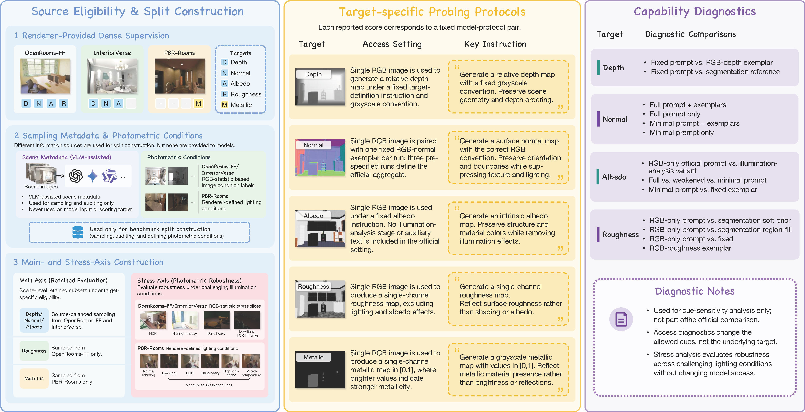

# PhysProbe: Probing Physical-Map Recovery in Frozen Vision Generative Models

**PhysProbe** benchmarks general-purpose image editors as single-image predictors
of depth, surface normals, albedo, roughness, and metallic maps, without
task-specific training. It evaluates physical-map fidelity with fixed access
settings, aligned supervision, valid masks, and target-specific metrics.

This repository provides retained sample manifests, runnable examples, API
experiment scripts, prompt templates, scene-audit utilities, pixel evaluators,
and paper-table aggregation with scene-cluster confidence intervals.

[](annotation/overview.pdf)

<p align="center"><em>Benchmark overview. Click the preview to open the PDF.</em></p>

[](annotation/results.pdf)

<p align="center"><em>Generated physical-map results. Click the preview to open the PDF.</em></p>

## Overview

A plausible-looking map can still have incorrect geometry, orientation,
reflectance, or material values. PhysProbe measures these properties separately
and distinguishes official target protocols from diagnostic changes in prompts
or available evidence.

Results are **model–access-setting measurements**: they depend on the backend,
model/deployment version, prompt, supplied reference images, and generation and
evaluation settings. They should not be read as interface-independent rankings
of a model family or as evidence about its undisclosed training data.

Start with the bundled example below, then follow the full workflow. Detailed
references are collected in the [documentation index](docs/README.md).

- [Runnable examples](#quick-start-run-the-bundled-examples)
- [Targets and metrics](#benchmark-targets-and-metrics)
- [Sources and retained samples](#data-sources-and-retained-samples)
- [Official access settings](#access-settings)
- [Model coverage](#available-api-models-and-configuration)
- [Main/stress runs](#run-main-axis-and-stress-experiments)
- [Access ablations](#run-access-protocol-ablations)
- [Evaluation and aggregation](#evaluate-and-aggregate-results)
- [Scene audits](#scene-annotation-and-auditing)

## Quick start: run the bundled examples

Run these commands from the repository root on Linux with Python 3.10 or newer:

```bash
python3 -m venv .venv
source .venv/bin/activate
python3 -m pip install -e ".[full]"
cp -n .env.example .env
```

Fill `AZURE_OPENAI_API_KEY`, `AZURE_OPENAI_ENDPOINT`, and
`AZURE_OPENAI_API_VERSION` in `.env`. The example uses an Azure deployment named
`gpt-image-1.5`; replace it below with your deployment name if needed.

```bash
# Offline: verify bundled assets and print all generation/evaluation commands.
python3 examples/run.py --dry-run

# Check that the required Azure settings are present; no API request is made.
python3 tools/check_env.py --provider azure

# Generate and evaluate one prediction for each of the five targets.
# Generation invokes the Azure API and incurs provider charges.
python3 examples/run.py --deployment gpt-image-1.5 \
  --output-root outputs/examples/gpt-image-1.5
```

Two bundled samples cover all five targets: OpenRooms-FF for depth, normal,
albedo, and roughness; PBR-Rooms for metallic. No full dataset download or SAM3
installation is needed for this walkthrough. Results are written under
`outputs/examples/gpt-image-1.5/predictions/` and `metrics/`.

```bash
# Run only one target.
python3 examples/run.py --target roughness --deployment gpt-image-1.5 \
  --output-root outputs/examples/gpt-image-1.5

# Re-evaluate saved example predictions without calling a generation API.
python3 examples/run.py --stage evaluate \
  --output-root outputs/examples/gpt-image-1.5
```

See [examples/README.md](examples/README.md) for sample provenance, paths,
deployment selection, and troubleshooting. These are small runnable examples;
full benchmark tables require the retained evaluation datasets.

## Benchmark targets and metrics

| Target | Predicted quantity | Sources | Main metric/profile | Additional diagnostics |
| --- | --- | --- | --- | --- |
| Depth | Relative scene depth | OpenRooms-FF, InteriorVerse | AbsRel-AI | RMSE-AI, MAE-AI, threshold accuracies, rank correlations, Boundary F1 |
| Normal | RGB-encoded view-space surface orientation | OpenRooms-FF, InteriorVerse | Acc@22.5 | Mean/median angular error, Acc@11.25, Acc@30, prediction-valid coverage |
| Albedo | Illumination-free RGB reflectance | OpenRooms-FF, InteriorVerse | MAE | PSNR, SSIM, LPIPS |
| Roughness | Scalar surface roughness in `[0,1]` | OpenRooms-FF | Image-macro RMSE, Bin-BMAE, Region-Macro MAE, SSIM | MAE, PSNR, optional LPIPS |
| Metallic | Scalar PBR metallic parameter in `[0,1]` | PBR-Rooms | MAE, RB-MAE, IoU, AP | Region/support and threshold-sensitivity diagnostics |

`AI` denotes affine-invariant depth scoring: prediction normalization, polarity
selection, and per-image affine fitting are performed by the evaluator. These
scores measure relative geometry rather than calibrated metric depth.

Normal colors encode orientation rather than RGB appearance. The official
protocol uses fixed convention exemplars; invalid predicted vectors affect
scoring support, so angular scores should be read with coverage diagnostics.

Roughness evaluation separates full-map error from errors balanced across GT
value bins and semantic color-ID regions. Metallic evaluation reports its four
metrics separately: sparse metallic regions mean that low full-map MAE alone
does not establish metallic-region recovery. Metallic positives use `>= 0.5`;
AP ranks continuous predictions. Pixels are pooled within each scene before
scene scores are averaged equally.

See [target evaluation](tools/evaluation/README.md) for executable commands and
[aggregation](tools/aggregation/README.md) for exact averaging rules.

## Data sources and retained samples

The source design is target-dependent. OpenRooms-FF supplies depth, normal,
albedo, and roughness; InteriorVerse supplies depth, normal, and albedo.
InteriorVerse roughness/metallic are excluded by the paper's channel-reliability
screening. The companion PBR-Rooms source supplies renderer-exported metallic
supervision and controlled lighting conditions.

| Target | MainAxis images | Stress images | Main/stress sources |
| --- | ---: | ---: | --- |
| Depth | 3,234 | 1,960 | OpenRooms-FF + InteriorVerse |
| Normal | 3,234 | 1,960 | OpenRooms-FF + InteriorVerse |
| Albedo | 3,234 | 1,960 | OpenRooms-FF + InteriorVerse |
| Roughness | 1,125 | 709 | OpenRooms-FF |
| Metallic | 960 | 450 | PBR-Rooms |

The current main/stress manifests are scene-disjoint for each target. Diagnostic
subsets reuse retained main/stress images by design. Independent normal
calibration manifests contain 50 pairs from each of OpenRooms-FF and
InteriorVerse for the shared Lotus/StableNormal convention adapter; these are
separate from the editor exemplars and official scoring samples.

- [Data index and manifest fields](data/README.md)
- [Source access, attribution, and licenses](data/sources.md)
- [Local dataset layout](docs/dataset.md)
- [Stress assignments and PBR-Rooms L0–L5 lighting](data/metadata/stress_assignments/README.md)
- [Roughness SAM3 regions](data/metadata/segmentation/README.md)
- [Normal calibration manifests](data/manifests/calibration/README.md)

Full datasets are obtained from their providers. Manifest paths identify samples
relative to source/split roots; some reference raw RGBE/EXR channels that require
processed exports before API generation. Main/stress launchers scan prepared
RGB directories, so those directories must contain the intended retained samples.
Prepare the retained sample trees before invoking the launchers. The bundled
examples already include the processed inputs needed for the walkthrough.

## Access settings

### Controlled RGB-to-map settings

Depth, roughness, and metallic receive one query RGB image and a fixed target
instruction. GT, masks, segmentation maps, cross-view evidence, and per-query
metric feedback are not generation inputs in the official setting. Depth
alignment and polarity selection occur only during scoring.

### Target-specific elicitation

Albedo also receives only the query RGB, with the fixed full A0 instruction
specifying illumination removal and structure preservation. Shared illumination
analysis belongs to diagnostic Albedo A1, not the official main/stress run.

Normal receives the query RGB followed by one fixed example RGB and its normal
map. E1, E2, and E3 define three independent runs in that order. For each exemplar,
scores are computed within each source, then source-balanced; the final result
averages the three exemplar-conditioned scores. Predictions are not fused or
selected by their scores.

### Diagnostic access variants

Ablations change instruction strength, exemplar access, analysis, or segmentation
cues. Setting IDs are target-specific: Albedo A1 and Normal A1 describe different
interventions. Diagnostic results remain separate from official comparisons.
See the [access-ablation protocol](experiments/ablation/PROTOCOL.md).

## Available API models and configuration

| Target | Available generation models | Query access |
| --- | --- | --- |
| Depth | Doubao, GPT Image 1.5/2.0, Gemini, Qwen Image 2.0, Wan 2.7 | RGB only |
| Normal | Doubao, GPT Image 1.5 | RGB + one fixed RGB/normal exemplar pair per run |
| Albedo | Doubao, GPT Image 1.5/2.0, Gemini, Qwen Image 2.0, Wan 2.7 | RGB only |
| Roughness | Doubao, GPT Image 1.5/2.0, Gemini, Qwen Image 2.0 | RGB only |
| Metallic | Doubao, GPT Image 1.5/2.0, Gemini, Qwen Image 2.0, Wan 2.7 | RGB only |

Canonical launcher model IDs are `doubao`, `gpt-image-1.5`, `gpt-image-2.0`,
`gemini`, `qwen2`, and `wan`, where supported. GPT uses Azure OpenAI; Gemini
uses Aihubmix. Open-source comparison inference remains in upstream projects;
see [comparison evaluation](docs/comparisons.md).

Configure only the providers used by your experiment in the root `.env`:

| Interface | Credential | Endpoint/version settings |
| --- | --- | --- |
| Doubao / Ark | `ARK_API_KEY` | `ARK_BASE_URL` |
| Qwen Image 2.0 / Wan 2.7 | `DASHSCOPE_API_KEY` | `DASHSCOPE_BASE_URL` |
| Gemini through Aihubmix | `AIHUBMIX_API_KEY` | `AIHUBMIX_BASE_URL` |
| GPT Image through Azure OpenAI | `AZURE_OPENAI_API_KEY` | `AZURE_OPENAI_ENDPOINT`, `AZURE_OPENAI_API_VERSION` |
| GLM scene audit | `GLM_API_KEY` | `GLM_BASE_URL` |
| Qwen scene-audit chat | `DASHSCOPE_API_KEY` | `QWEN_BASE_URL` |

GPT Image 1.5/2.0 share the Azure settings across targets. Native DashScope image
and chat-compatible URLs serve different APIs. Explicit CLI values override the
process environment, followed by `.env` and script defaults. Credentials remain
in the environment rather than task command arguments. See
[API configuration](docs/api_configuration.md) for detailed behavior, including
Gemini options that are accepted but not sent to its backend.

The model table describes API generation entries implemented here. Upstream
open-source inference and specialist checkpoints are used in their own
projects; this repository supplies shared scoring and aggregation for their
predictions. It does not include a training pipeline or model checkpoints.

## Run main-axis and stress experiments

Every target has one shared `prompts.py` and three shell entry points:

| Entry | Purpose |
| --- | --- |
| `scripts/run.sh` | Foreground generation over the selected datasets |
| `scripts/start.sh` | Detached execution with a log and PID/status records |
| `scripts/progress.sh` | Check expected prediction images and remaining queries |

All commands below run from the repository root. Begin with the included sample:

```bash
bash experiments/main_stress/albedo/scripts/run.sh --model gpt-image-1.5 \
  --dataset openroomff_mainaxis --input-root examples/assets \
  --output-root outputs/examples/albedo --max-generate 1 --dry-run
```

For a full run, replace `/path/to/prepared_data` with your prepared retained
source/split root. Preview first, then remove `--dry-run` to invoke the API:

```bash
bash experiments/main_stress/albedo/scripts/run.sh --model gpt-image-1.5 \
  --split mainaxis --input-root /path/to/prepared_data \
  --output-root outputs/main_stress/albedo/gpt-image-1.5 --dry-run

# Detached execution after checking the preview.
bash experiments/main_stress/albedo/scripts/start.sh --model gpt-image-1.5 \
  --split mainaxis --input-root /path/to/prepared_data \
  --output-root outputs/main_stress/albedo/gpt-image-1.5

bash experiments/main_stress/albedo/scripts/progress.sh --model gpt-image-1.5 \
  --split mainaxis --input-root /path/to/prepared_data \
  --output-root outputs/main_stress/albedo/gpt-image-1.5 --watch 10
```

Use `--split stresstest` for stress queries. `--max-generate N` selects a smoke
subset per dataset; omit it for full evaluation. `--deployment` overrides the
selected generation model/deployment. Keep model, path, sample-limit, and
exemplar options consistent between run/start/progress. Use distinct output
roots per target, model, and protocol.

Depth/normal/albedo use source-specific OpenRooms-FF and InteriorVerse folders;
roughness uses OpenRooms-FF only. Metallic expects a PBR-Rooms root containing
`mainaxis/` and `stresstest/`. Normal schedules E1/E2/E3 by default; select
`--exemplar E1` only for a single-reference smoke run.

Detailed entries, input roots, and output layouts:
[Albedo](experiments/main_stress/albedo/README.md) ·
[Depth](experiments/main_stress/depth/README.md) ·
[Normal](experiments/main_stress/normal/README.md) ·
[Roughness](experiments/main_stress/roughness/README.md) ·
[Metallic](experiments/main_stress/metallic/README.md).

These launchers generate predictions and run records. They do not perform pixel
evaluation. A finished job can still contain provider-skipped queries; inspect
logs, expected-image counts, and failures before reporting a complete run.

## Run access-protocol ablations

| Target | Settings | API models |
| --- | --- | --- |
| Albedo | A0 full RGB-only; A1 shared illumination analysis; A2 weakened; A3 minimal; B0 exemplar | Same six as the albedo main runner |
| Depth | A0 RGB-only; A1 RGB/depth exemplar; A2 segmentation | Same six as the depth main runner |
| Normal | A0 full + exemplar; A1 full RGB-only; A2 minimal + exemplar; A3 minimal RGB-only | Doubao, GPT Image 1.5 |
| Roughness | A0 RGB-only; A1 soft segmentation; A2 segmentation + region fill; A3 exemplar | Doubao, GPT Image 1.5/2.0, Gemini |

The paper has no metallic access-ablation matrix. Each implemented target uses
96 selected queries; Albedo/Depth/Normal balance source and main/stress cells,
while Roughness uses 48 OpenRooms-FF queries per partition.

```bash
bash experiments/ablation/depth/scripts/run.sh --model gpt-image-1.5 \
  --input-root /path/to/processed_data --settings A0 A1 A2 --dry-run
```

Unlike main/stress launchers, ablation launchers select queries directly from
the released manifest. Even a dry-run requires those processed files and any
setting-specific cues to exist. Depth A2 and Roughness A1/A2 need paired
segmentation. Albedo A1 reads one shared query-only Doubao analysis cache,
generated once before editor runs. Normal A0/A2 schedule E1/E2/E3 independently.

See the [ablation run guide](experiments/ablation/README.md) and its target pages
for cache creation, required cues, foreground/background commands, and outputs.

## Evaluate and aggregate results

### Image handling and masking

Doubao, Gemini, Qwen, and Wan receive original file bytes. GPT input images,
including supplied reference images, are converted to RGB PNG and resized to
1536 × 1024 with Lanczos, without padding. Provider responses are saved byte for
byte; the evaluator scores the full returned canvas. Roughness diagnostic A2
additionally retains a raw prediction and derives a separate region-filled map.

Valid masks are enabled by default. Prediction interpolation follows the paper:
nearest-neighbor for normals, bicubic for albedo, and bilinear for depth,
roughness, and metallic. Masks and region labels use nearest-neighbor. See the
[image I/O policy](experiments/IMAGE_IO.md) and [evaluation commands](tools/evaluation/README.md).

### Pixel evaluation

The bundled example can score its existing predictions without provider calls:

```bash
python3 examples/run.py --stage evaluate \
  --output-root outputs/examples/gpt-image-1.5
```

For full runs, invoke the target evaluator against matching GT, predictions,
valid masks, and any required regions. Keep source and normal-exemplar exports
separate. Roughness Region-Macro needs the frozen SAM3 color-ID regions; metallic
requires the dedicated `MetallicEvalMask`. The evaluator guide includes all five
example commands and directory pairing guidance.

### Tables and confidence intervals

Aggregate the completed evaluator CSVs, not generation folders:

```bash
python3 tools/aggregation/aggregate_results.py \
  --evaluation-root /path/to/evaluation_exports \
  --output-dir outputs/aggregation --resamples 1000 --seed 42
```

The input root contains `1_mainaxis`, `2_stresstest`, and `3_comparison`.
The [aggregation guide](tools/aggregation/README.md) defines model/source folder
names, paper setting directory names, Stress assignment modes, and output files.
It is also the single entry point for paper-table confidence intervals.

Depth/albedo scores are balanced across sources. Normal additionally averages
E1/E2/E3 scores. Roughness uses its image/bin/region estimators; diagnostic
Balanced RMSE has a separate partition-balanced definition. Metallic averages
pooled per-scene metrics. Scene-cluster bootstrap retains all images of each
sampled scene and shares draws across comparable methods and normal exemplars.

Inspect `tables.csv`/`tables.json` and `audit.json`. Support-count flags do not
establish exact sample identity; missing, extra, and replaced samples need
separate checks.

## Scene annotation and auditing

The annotation workflow creates scene category, lighting, and plausibility
metadata for sampling and auditing. Its three initial models are Doubao, GLM,
and Qwen; the offline merger preserves their evidence and voting results.
Second-stage review is a separate operation on selected scenes.

Reproduce the bundled scene's merge without images or API calls:

```bash
python3 annotation/scripts/merge_scene_audits.py \
  --root examples/annotations/openroomff_mainaxis \
  --doubao-dir doubao --glm-dir glm --qwen-dir qwen \
  --output "$PWD/outputs/examples/annotation/merged" --seed 42
```

See the [scene-audit guide](annotation/README.md) for initial-audit commands,
record fields, merge rules, and review behavior. Scene-audit field meanings and merge rules are documented there. The reviewer
processes supplied scenes; review selection is a separate step.

## Reproducibility and release scope

See the [reproducibility guide](docs/reproducibility.md) for execution settings,
experiment records, and release scope.

The release provides manifests, calibration indexes, prompts, reference assets,
scene-audit utilities, evaluators, and aggregation code. The small runnable
examples are included. Full datasets, provider credentials, model weights,
complete proprietary outputs, and a complete frozen run-record collection are
not bundled. Provider-side updates can change future generation behavior.
Keep the deployment/backend, exact prompt and input order, request settings,
exemplars, completion status, prediction hashes/dimensions, and evaluator
configuration with each new experiment.

## Repository layout

```text
annotation/                 Scene audit scripts, prompts, and merge tools
data/
  manifests/                MainAxis, Stress, diagnostic, calibration indexes
  metadata/                 Lighting assignments and segmentation conventions
docs/                      Installation, protocols, and workflow references
examples/                  Runnable two-sample walkthrough and audit records
experiments/
  main_stress/              Target-wise API generation and shared launchers
  ablation/                 Diagnostic access settings and cue workflows
src/                       Shared configuration, image I/O, and runtime code
tests/                     Offline regression checks
tools/
  evaluation/               Target-specific pixel evaluators
  aggregation/              Tables, coverage checks, scene-cluster intervals
  segmentation/             SAM3 region generation
outputs/                   Local artifacts, ignored by Git
```

## Offline checks

```bash
python3 -m unittest discover -s tests -v
python3 examples/run.py --dry-run
```

Tests use mocked responses to check prompt wiring, image handling, provider
configuration, diagnostic inputs, metric estimators, and scene merging. They do
not verify live provider availability, account permissions, or output quality.

## Documentation

[Documentation index](docs/README.md) · [Installation](docs/install.md) ·
[Environment](docs/environment.md) · [API configuration](docs/api_configuration.md) ·
[Dataset layout](docs/dataset.md) · [Main experiments](docs/main_experiments.md) ·
[Ablations](docs/ablations.md) · [Comparisons](docs/comparisons.md).

## Citation and license

Please cite the accompanying paper when using PhysProbe, its retained samples,
or its evaluation protocol.

The benchmark draws on the following resources:

| Resource | Official repository or release | Citation |
| --- | --- | --- |
| OpenRooms-FF | [OpenRooms-FF](https://github.com/bring728/OpenRooms_FF) · [OpenRooms](https://github.com/ViLab-UCSD/OpenRooms) | MAIR (CVPR 2023); OpenRooms (CVPR 2021) |
| InteriorVerse | [Dataset website](https://interiorverse.github.io/) · [IndoorInverseRendering](https://github.com/jingsenzhu/IndoorInverseRendering) | Learning-Based Inverse Rendering of Complex Indoor Scenes with Differentiable Monte Carlo Raytracing (SIGGRAPH Asia 2022) |
| PBR-Rooms | [Hugging Face dataset](https://huggingface.co/datasets/pbr-rooms-benchmark/PBR-Rooms) | Anonymous dataset artifact; formal paper citation pending |
| Infinigen (PBR-Rooms generation pipeline) | [Infinigen](https://github.com/princeton-vl/infinigen) | Infinigen (CVPR 2023); Infinigen Indoors (CVPR 2024) |

See the [citation guide](data/sources.md#citation-guide) for which references
apply to each source. Download [BibTeX entries](data/references.bib) for the
published papers and the anonymous PBR-Rooms dataset URL reference.

Original code is licensed under [MIT](LICENSE). Dataset assets and model weights
retain their own terms; see [Data Sources and Attribution](data/sources.md).
Contribution and security reporting instructions are in
[CONTRIBUTING.md](CONTRIBUTING.md) and [SECURITY.md](SECURITY.md).
